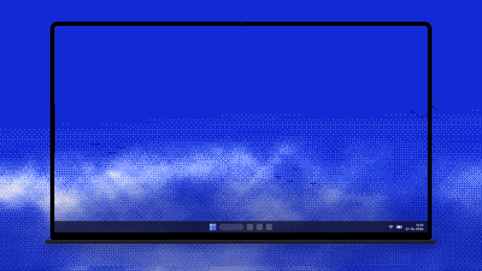
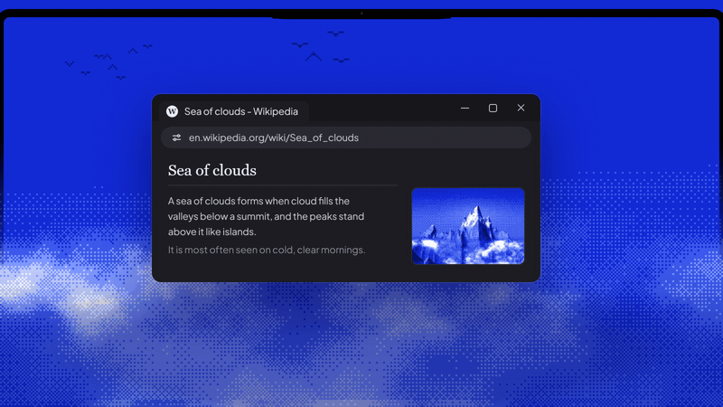
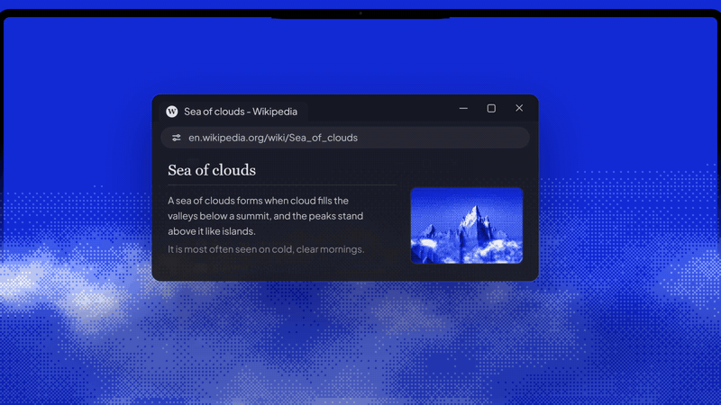
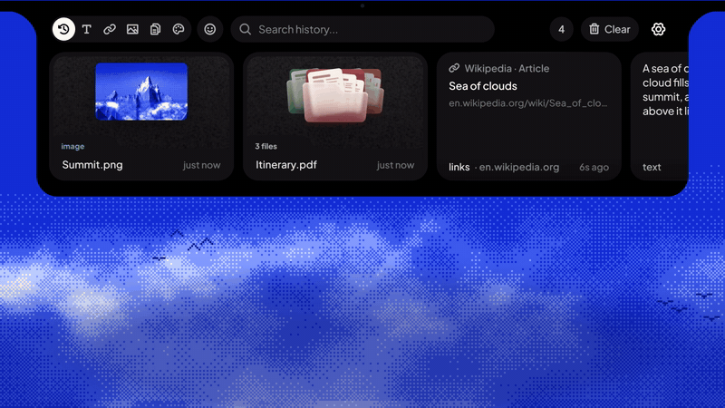
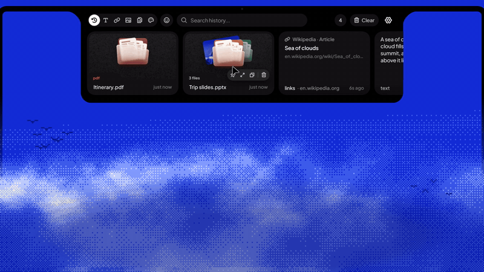
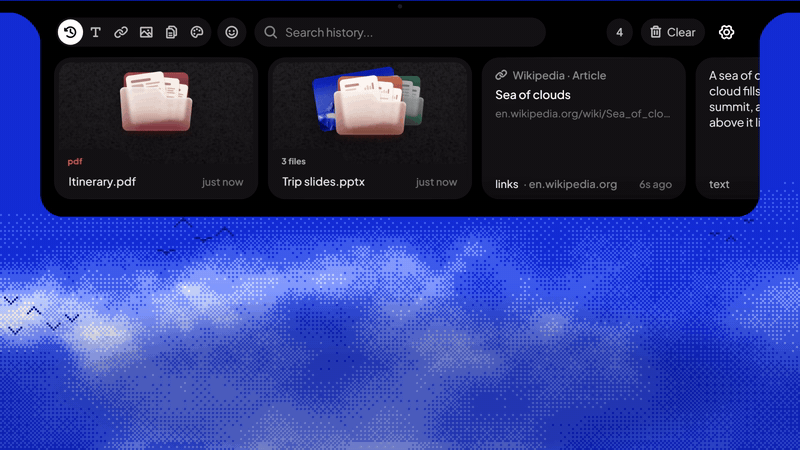
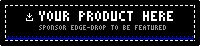
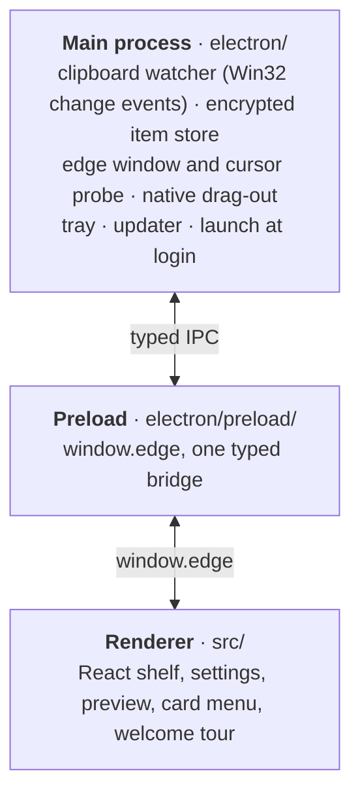

<p align="center">
  
</p>

<h1 align="center">Edge-Drop</h1>

<p align="center">
  <b>A clipboard shelf that lives on the edge of your screen.</b><br/>
  Move your pointer to the edge and it opens. Everything you copy is there, ready to paste or drag into any app.<br/>
  <sub>Or press <kbd>Alt</kbd> + <kbd>C</kbd> &nbsp;·&nbsp; <a href="https://www.edgedrop.app">edgedrop.app</a></sub>
</p>

<p align="center">
  <a href="https://apps.microsoft.com/detail/9P3JMHN9M4NR" target="_blank"></a>
  &nbsp;
  <a href="https://github.com/Deepender25/Edge-Drop/releases/latest" target="_blank"></a>
</p>

<p align="center">
  <a href="#download"></a>
  <a href="#whats-new-in-040"></a>
  <a href="#demos"></a>
  <a href="#features"></a>
  <a href="#privacy--security"></a>
  <a href="#build-from-source"></a>
  <a href="#support--sponsor"></a>
</p>

<p align="center">
  <a href="https://github.com/Deepender25/Edge-Drop/releases"></a>
  <a href="https://github.com/Deepender25/Edge-Drop/releases"></a>
  <a href="https://github.com/Deepender25/Edge-Drop/stargazers"></a>
  <a href="LICENSE"></a>
  
</p>

> [!NOTE]
> Edge-Drop is an independent open-source project. It is not affiliated with, endorsed by, sponsored by, or connected to Microsoft or the Microsoft Edge browser in any way.

<p align="center"></p>

##  Why Edge-Drop

Getting something you copied earlier usually means stopping what you're doing: open `Win+V`, arrow through a list, or dig into a tray menu. Edge-Drop keeps your clipboard history on the edge of the screen instead, out of the way until you reach for it.

<table>
  <tr>
    <td width="33%" align="center" valign="top">
      <br/>
      <b>1. Copy anything</b><br/>
      <sub>Text, links, images, screenshots and files land on the shelf as you copy them.</sub>
    </td>
    <td width="33%" align="center" valign="top">
      <br/>
      <b>2. Point at the edge</b><br/>
      <sub>The shelf opens when your pointer reaches the edge, and closes when you leave.</sub>
    </td>
    <td width="33%" align="center" valign="top">
      <br/>
      <b>3. Click or drag</b><br/>
      <sub>Click a card to paste it into the app you're in, or drag it into any window.</sub>
    </td>
  </tr>
</table>

It's built for the way people actually work: screenshots, snippets, file paths, links and assets moving between many windows all day.
<p align="center"></p>

##  What's new in 0.4.0

<table>
  <tr>
    <td width="33%" align="center" valign="top">
      <br/>
      <b>A welcome tour played by the real app</b><br/>
      <sub>Eight short steps show the shelf at work on a laptop screen, in your device's language. It opens once after you update; replay it any time from the tray.</sub>
    </td>
    <td width="33%" align="center" valign="top">
      <br/>
      <b>Notes and a right-click menu</b><br/>
      <sub>Right-click any card for the actions that fit it, or add a short note. Search finds notes, and noted cards are never auto-deleted or cleared.</sub>
    </td>
    <td width="33%" align="center" valign="top">
      <br/>
      <b>Drag and drop, redesigned</b><br/>
      <sub>The edge bar swells as a drag comes near and the shelf opens into a drop zone. Pull a file out of a stack onto a light on the screen edge.</sub>
    </td>
  </tr>
</table>

**Cards and preview**
- The right-click menu has paste, paste as plain text, copy, note, pin, preview and delete, plus actions for each kind of card: open a link or copy it without its tracking parameters, copy a color in its other formats (HEX, RGB, HSL), show a file in its folder or copy its path, save an image to Downloads.
- Link cards show the site and the kind of page (for example "GitHub · Issue") with a readable title, for 400+ sites, worked out offline.
- New frosted-glass file icons; folders open when you hover them; file and image cards have a subtle texture.
- An open stack shows a photo grid for pictures and a list for files.
- The preview sizes images to their shape and lists a color's HEX, RGB and HSL values to copy.
- When the shelf reopens at the top of the list, a button takes you back to where you were.

**Look and feel**
- The shelf opens and closes with a spring, and its content fades in behind the shape.
- A new copy indicator that grows out of the edge bar.
- A redesigned filter bar with the emoji picker on its own button, and a clear button in search.
- One icon set and one style for every hover button.
- Pinning or unpinning lights the edge of the shelf the card moves to.
- A new, softer set of UI sounds, and settings regrouped into clear sections in both docks.
- An **Open Delay** setting (0–1000 ms) makes the edge wait before opening, if instant hover feels too eager.

**Languages**
- Every string in the app is translated into all 31 languages, with correct plural forms ("1 file", "5 files") and sizes written as each language writes them.

**Fixes and performance**
- Files copied in File Explorer are read natively instead of through PowerShell (about 300 ms down to under 1 ms), and file names with non-English characters are no longer garbled or dropped.
- No more freezes on the first scroll or drag after launch.
- Switching emoji categories no longer stutters.
- Lower CPU use while idle: the audio device is released 2 seconds after the last sound instead of running all the time.
- If saved history can't be read (for example after Windows' encryption keys are lost, or the profile moves to another PC), it's set aside and merged back once it can be read, instead of being overwritten. Saves are atomic, so a crash mid-save can't cut the history short.
- Updated to Electron 45 (Electron 34 is out of support).
- A few Cyrillic and Vietnamese letters now use the app's own fonts.
- The packages no longer carry about 1 MB of unused build files.

<sub>Full history: <a href="https://www.edgedrop.app/changelog">edgedrop.app/changelog</a></sub>

<p align="center"></p>

##  Demos

<p align="center">
  <b>Open it from the edge</b><br/>
  <sub>Move the pointer to the edge of the screen; the shelf opens, and closes again when you leave.</sub><br/><br/>
  
</p>

<table>
  <tr>
    <td width="50%" align="center" valign="top">
      <b>Left, right or top</b><br/>
      <sub>Dock the shelf on any of three edges, on the display you choose.</sub><br/><br/>
      
    </td>
    <td width="50%" align="center" valign="top">
      <b>Copy as usual</b><br/>
      <sub>Text, links, images and files land on the shelf the moment you copy them.</sub><br/><br/>
      
    </td>
  </tr>
  <tr>
    <td width="50%" align="center" valign="top">
      <b>Drag in, drag out</b><br/>
      <sub>Drop links and files onto the shelf; drag anything back out into any app.</sub><br/><br/>
      
    </td>
    <td width="50%" align="center" valign="top">
      <b>Stacks</b><br/>
      <sub>Pull a file out of a stack, or drop cards together to make one.</sub><br/><br/>
      
    </td>
  </tr>
  <tr>
    <td width="50%" align="center" valign="top">
      <b>Full-size preview</b><br/>
      <sub>Open a stack or a card to see everything in it, then paste or copy what you pick.</sub><br/><br/>
      
    </td>
    <td width="50%" align="center" valign="top">
      <b>Notes and search</b><br/>
      <sub>Add a note from the right-click menu; search finds it later.</sub><br/><br/>
      
    </td>
  </tr>
</table>

<p align="center"></p>

##  Download

<p align="center">
  Edge-Drop runs on <b>Windows 10 and 11</b> (64-bit). Both editions are the same app; they differ only in how they install and update.
</p>

<table>
  <tr>
    <td width="50%" align="center" valign="top">
      <br/>
      <br/>
      <b>Microsoft Store</b><br/>
      <sub>Recommended for most people</sub><br/><br/>
      <a href="https://apps.microsoft.com/detail/9P3JMHN9M4NR" target="_blank"></a>
      <p align="left">
        ✓ &nbsp;Updates automatically through the Store<br/>
        ✓ &nbsp;Installs without a SmartScreen warning<br/>
        ✓ &nbsp;Installs and uninstalls in one click
      </p>
    </td>
    <td width="50%" align="center" valign="top">
      <br/>
      <br/>
      <b>Windows installer (.exe)</b><br/>
      <sub>From GitHub releases</sub><br/><br/>
      <a href="https://github.com/Deepender25/Edge-Drop/releases/latest" target="_blank"></a>
      <p align="left">
        ✓ &nbsp;Built-in updates: <b>Automatic</b>, <b>Notify me</b> or <b>Off</b><br/>
        ✓ &nbsp;Installs for your account, in the folder you choose<br/>
        ✓ &nbsp;Start menu and desktop shortcuts
      </p>
    </td>
  </tr>
</table>

> [!NOTE]
> The GitHub installer isn't code-signed yet, so Windows SmartScreen may warn the first time you run it. Choose **More info → Run anyway**, or install from the Microsoft Store instead.

<p align="center"></p>

##  Support & Sponsor

<p align="center">
  <b>Edge-Drop is free and open source, and always will be.</b><br/>
  If it saves you time every day, you can help keep it going.
</p>

<table>
  <tr>
    <td width="50%" align="center" valign="top">
      <br/>
      <br/>
      <b>Worldwide · Ko-fi</b><br/>
      <sub>Buy me a coffee from anywhere in the world.</sub><br/><br/>
      <a href="https://ko-fi.com/deepender" target="_blank"></a><br/><br/>
      <a href="https://ko-fi.com/deepender" target="_blank"></a>
    </td>
    <td width="50%" align="center" valign="top">
      <br/>
      <br/>
      <b>India · UPI</b><br/>
      <sub>Pay with GPay, PhonePe, Paytm or any UPI app.</sub><br/><br/>
      <a href="https://www.edgedrop.app/supportedgedrop/upi" target="_blank"></a><br/><br/>
      <a href="https://www.edgedrop.app/supportedgedrop/upi" target="_blank"></a>
    </td>
  </tr>
</table>

### Sponsors

A huge thank you to the sponsors who keep Edge-Drop going:

<table>
  <tr>
    <td width="72" align="center" valign="middle">
      <a href="https://elitistreview.com/" target="_blank"></a>
    </td>
    <td valign="middle">
      <b><a href="https://elitistreview.com/" target="_blank">Elitistreview</a></b><br/>
      <i>When it comes to wine, there is an objective reality out there, and it is on Elitistreview.com.</i><br/>
      <sub><a href="https://elitistreview.com/" target="_blank">Website</a> · <a href="https://x.com/Elitistreview" target="_blank">X</a> · <a href="https://bsky.app/profile/elitistreview.com" target="_blank">Bluesky</a></sub>
    </td>
  </tr>
</table>

<p align="center">
  <a href="https://ko-fi.com/deepender" target="_blank"></a>
</p>
<p align="center">
  <sub>Want your product featured here, in front of the developers who visit this page? Sponsor on <a href="https://ko-fi.com/deepender" target="_blank">Ko-fi</a> or <a href="https://www.edgedrop.app/supportedgedrop/upi" target="_blank">UPI</a> and share your link.</sub>
</p>

<p align="center"></p>

##  Features

<table>
  <tr>
    <td width="50%" valign="top">
      <br/>
      <b>The shelf</b>
      <ul>
        <li>Opens from the <b>left</b>, <b>right</b> or <b>top</b> edge of any display, and remembers that display across restarts. <kbd>Alt</kbd> + <kbd>C</kbd> toggles it (change it in Settings).</li>
        <li>Tune the trigger zone (size, 1–7 px thickness, position), an <b>Open Delay</b> (0–1000 ms), the shelf's height and where it sits along the edge. Hover opening can be turned off.</li>
        <li>Never takes keyboard focus from the app you're in, so clicking a card pastes straight into it.</li>
        <li>Stays out of fullscreen games, videos and presentations; capture pauses while the PC sleeps or is locked.</li>
      </ul>
    </td>
    <td width="50%" valign="top">
      <br/>
      <b>Everything you copy</b>
      <ul>
        <li><b>Text and rich text</b> (with <b>Paste as plain text</b>), <b>links</b>, <b>images and screenshots</b>, <b>files and folders</b>, <b>color codes</b> as swatches, <b>spreadsheet cells</b>, and <b>code</b> with syntax highlighting in the preview.</li>
        <li><b>Any file, any size.</b> File cards point to the originals, so a 4 GB video is captured as instantly as a text file.</li>
        <li>Copying something again moves it to the top with a ×N count.</li>
        <li>Link cards work offline: nothing is fetched to build them.</li>
      </ul>
    </td>
  </tr>
  <tr>
    <td width="50%" valign="top">
      <br/>
      <b>Drag and drop</b>
      <ul>
        <li><b>Drag in</b> files, folders, links, text and web images. The shelf opens into a drop zone as your drag reaches the edge.</li>
        <li><b>Drag out</b> any card into any app: files as the originals, images as named image files, text and links as text files.</li>
        <li><b>Stacks</b> hold up to 10 files or images. Drop a card onto another (or onto an open preview) to combine; drag an item to the light on the screen edge, or ungroup, to split.</li>
      </ul>
    </td>
    <td width="50%" valign="top">
      <br/>
      <b>Find and organize</b>
      <ul>
        <li><b>Search</b> across text, file names, link titles and notes, and <b>filter</b> by type, including a <b>Colors</b> tab.</li>
        <li><b>Notes</b> (up to 120 characters) from the right-click menu. Noted cards are never auto-deleted or cleared.</li>
        <li><b>Pin</b> cards to keep them at the top, in a pinned section for each filter.</li>
        <li>A <b>right-click menu</b> with the actions that fit each card, a full-size <b>preview</b> with multi-select, and an <b>emoji picker</b>.</li>
      </ul>
    </td>
  </tr>
  <tr>
    <td width="50%" valign="top">
      <br/>
      <b>Your history, your rules</b>
      <ul>
        <li>Keep <b>100 to 1000</b> items (250 by default).</li>
        <li><b>Auto-delete</b> after 1 hour, 6 hours, 24 hours or 7 days, or never; optionally clear unpinned items on restart.</li>
        <li><b>Clear</b> the last hour, 6 hours, 24 hours or everything, for just the type or search you're looking at. Pinned and noted cards stay.</li>
        <li><b>Incognito</b> pauses capture with one click, from Settings or the tray.</li>
      </ul>
    </td>
    <td width="50%" valign="top">
      <br/>
      <b>Make it yours</b>
      <ul>
        <li><b>31 languages</b>, with right-to-left layouts for Arabic, Hebrew and Persian.</li>
        <li><b>Text size</b> (Small, Normal, Large), four <b>copy indicator</b> styles, and subtle synthesized <b>sound effects</b> you can turn off.</li>
        <li>Settings grouped into <b>Behaviour</b>, <b>Position</b> and <b>Appearance</b>.</li>
        <li>A <b>welcome tour</b> for new users, replayable from the tray.</li>
      </ul>
    </td>
  </tr>
</table>

<p align="center"></p>

##  Privacy & Security

Edge-Drop handles everything you copy, so it's built to keep that on your PC.

- **Local only.** Your history stays on your computer. There's no account, no cloud sync, and no telemetry or analytics.
- **Network use is limited to:** checking GitHub for updates (installer edition, unless updates are set to Off), downloading a web image you drag onto the shelf, and links you choose to open.
- **Encrypted at rest.** History is encrypted with Windows' own data protection (DPAPI, via Electron `safeStorage`) and is never rewritten as plain text once encrypted.
- **Respects private copies.** Content marked by the app it came from as not for clipboard history or monitoring (the Windows flags password managers use) is skipped. Incognito pauses capture entirely.
- **Never loses history.** Saves are atomic (write, flush, rename). History that can't be read is set aside and merged back later, never overwritten.

| Control | How |
| :--- | :--- |
| Runtime | Electron 45.1 |
| Renderer isolation | `contextIsolation` on, `nodeIntegration` off, sandboxed renderers |
| Typed IPC | Every channel and payload is typed in `shared/ipc.ts`, shared by both sides |
| Content Security Policy | The UI can't make network requests (`connect-src 'self'`) |
| External links | New windows are refused; only `http(s)`, `mailto`, `tel` and Store links open, in your default browser |
| PowerShell | Called by absolute path with `execFile` (no shell), with validated file paths |

See [PRIVACY.md](PRIVACY.md) for the full privacy policy.

<p align="center"></p>

##  Build from source

**Requirements:** Windows 10 or 11, and **Node.js 22.12 or newer** (required by Electron 45).

```bash
git clone https://github.com/Deepender25/Edge-Drop.git
cd Edge-Drop
npm install
npm run dev          # Electron + Vite with hot reload
```

| Command | What it does |
| :--- | :--- |
| `npm run dev` | Run the app in development mode |
| `npm run typecheck` | Type-check the main and renderer code |
| `npm test` | Run the test suite (Vitest) |
| `npm run build:github` | Build the NSIS installer (`dist/Edge-Drop-Setup-<version>.exe`) |
| `npm run build:store` | Build the Microsoft Store package (`.appx`) |

> [!NOTE]
> Quit any installed copy of Edge-Drop before `npm run dev`: both use the same profile, and only one instance can run at a time. If packaging fails with `EBUSY: resource busy or locked`, close running Edge-Drop or dev instances and try again.

<p align="center"></p>

##  Architecture

Edge-Drop is an Electron app in three isolated layers that talk only through a typed bridge.



- **Main process (`electron/`)** talks to Windows. Clipboard changes arrive as `WM_CLIPBOARDUPDATE` events, with a slow timer as a safety net, and are read natively through [koffi](https://koffi.dev). It also handles the history store, the edge window and cursor probe, native drag-out, the tray, launch at login and updates.
- **Preload (`electron/preload/`)** exposes one typed API, `window.edge`, defined in `shared/bridge.ts` and `shared/ipc.ts`.
- **Renderer (`src/`)** is React 18 with Zustand for state and Framer Motion for motion. It contains the shelf, settings, preview, card menu and the onboarding tour (`src/onboarding/`).

<details>
<summary><b>Project structure</b></summary>

```
Edge-Drop/
├─ shared/                    Types and contracts used by every layer
│  ├─ ipc.ts                  IPC channels and payload types
│  ├─ bridge.ts               The window.edge API
│  ├─ types.ts                Items, settings, drag requests
│  └─ itemMeta.ts             Notes on cards
├─ electron/
│  ├─ main/                   App lifecycle and Windows integration
│  │  ├─ index.ts             Startup, single instance, edgelocal:// protocol
│  │  ├─ window.ts            The edge window, cursor polling, displays
│  │  ├─ stickProbe.ts        Where the pointer is relative to the dock
│  │  ├─ drag.ts              Native drag-out and drag images
│  │  ├─ fullscreen.ts        Fullscreen detection
│  │  ├─ tray.ts              Tray menu
│  │  ├─ updater.ts           Updates (installer edition)
│  │  ├─ loginItems.ts        Launch at login (installer edition)
│  │  ├─ onboardingWindow.ts  The welcome tour window
│  │  └─ ipc.ts               IPC handlers
│  ├─ clipboard/
│  │  ├─ ClipboardWatcher.ts  Change detection and capture
│  │  ├─ osClipboard.ts       Native clipboard reads and writes
│  │  └─ formats.ts           Format detection, file lists, privacy flags
│  ├─ store/
│  │  ├─ ItemStore.ts         Encrypted, atomic history storage
│  │  └─ settings.ts          User settings
│  └─ preload/                The typed bridge
├─ src/
│  ├─ components/             Shelf, cards, preview, card menu, settings
│  ├─ onboarding/             The welcome tour
│  ├─ hooks/                  Edge hover, filtering, drag-out
│  ├─ i18n/                   31 languages
│  ├─ lib/                    Sounds, link previews, colors, code detection
│  ├─ store/                  App state (Zustand)
│  └─ styles/                 CSS
├─ resources/                 Icons, file icons, Store assets
└─ tests/                     Vitest suite
```

</details>

**Tech stack:** Electron 45 · React 18 · TypeScript 5.9 · Vite 5 with electron-vite · Zustand · Framer Motion · koffi (Win32) · resvg (drag images) · electron-updater · Vitest

<p align="center"></p>

##  Roadmap

- [x] Left, right and top docks on any display
- [x] Search, filters, pins and notes
- [x] Stacks: combine and split
- [x] Three update modes for the installer edition
- [x] 31 languages with right-to-left support
- [x] Welcome tour
- [ ] **AI organization:** group related items automatically
- [ ] **AI summaries** for stacks and long copies
- [ ] **macOS and Linux ports**
- [ ] **Plugin SDK** for custom formats and drag-out targets
- [ ] **Opt-in, end-to-end encrypted sync** of pinned items

<p align="center"></p>

##  Contributing

Edge-Drop is Apache-2.0 licensed and welcomes contributions. The most useful things right now:

1. **Report bugs** through [Issues](https://github.com/Deepender25/Edge-Drop/issues), especially crashes, privacy edge cases, and apps whose copies show up wrong. Tell us which app you copied from and what you copied.
2. **Help port Edge-Drop** to macOS or Linux.
3. **Pick a roadmap item.** Open an issue first to agree on the scope, then send a pull request from a feature branch.

Please run `npm run typecheck` and `npm test` before opening a pull request. Everyone taking part is expected to follow the [Code of Conduct](CODE_OF_CONDUCT.md).

<p align="center"></p>

##  License

Apache License 2.0. See [LICENSE](LICENSE). Commercial and non-commercial use, modification and distribution are all permitted with attribution.

<p align="center"></p>

##  Star history

<p align="center">
  <a href="https://github.com/Deepender25/Edge-Drop/stargazers"></a>
</p>

<p align="center"></p>

<p align="center">
  <sub>Support Edge-Drop on <a href="https://ko-fi.com/deepender" target="_blank">Ko-fi ☕</a> &nbsp;·&nbsp; Star it on <a href="https://github.com/Deepender25/Edge-Drop" target="_blank">GitHub ⭐</a></sub>
</p>
